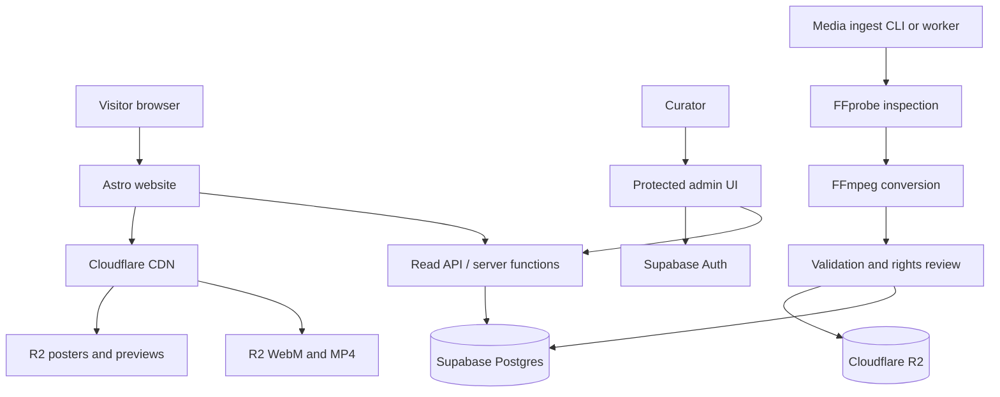

# Loopscape — Product Design & Architecture

**Status:** V1 architecture proposal  
**Version:** 1.0  
**Last updated:** 2026-11-18

## 1. Product overview

Loopscape is a curated, mood-led library of short, seamless looping visual assets. It should feel like an editorial inspiration destination rather than a generic GIF search engine. V1 differentiates through quality, coherent art direction, creator attribution, fast browsing, and reliable downloads—not inventory size.

### Product principles

1. Curation over volume: launch with approximately 100 excellent assets.
2. Poster-first delivery: do not download full animation files until playback is useful.
3. Mood-led discovery: organize by visual feeling, not only conventional subject tags.
4. Rights by design: provenance, permissions, and attribution are required publishing metadata.
5. Progressive enhancement: static browsing must remain useful with reduced motion, poor connectivity, or video playback failure.
6. Operational simplicity: use managed infrastructure until real usage justifies added complexity.

## 2. V1 scope

### Included

- Responsive dark editorial gallery.
- Home page with featured collections and recent/highlighted loops.
- Mood collections: **Lofi, Kinetic, Cozy, Glitch, Geometric, Ethereal, Noir**.
- Search by title, mood, tags, and creator.
- Asset detail pages with creator attribution, license/usage notes, and download actions.
- Poster-first media delivery and viewport-aware playback.
- Protected curator/admin workflow for ingest, review, and publishing.
- Basic view, play, download, and share analytics.
- SEO metadata, sitemap, accessible controls, and shareable asset URLs.

### Out of scope

- Public user uploads and submissions.
- Comments, likes, messaging, and social profiles.
- Unlicensed scraping or bulk rehosting from third-party platforms.
- Dedicated recommendation/embedding infrastructure.
- Public accounts, subscriptions, and marketplace features.

## 3. Information architecture

| Route | Purpose |
|---|---|
| `/` | Editorial landing page and featured loops |
| `/explore` | Searchable, filterable gallery |
| `/mood/[slug]` | Curated mood collection |
| `/loop/[slug]` | Asset detail, creator, rights, variants, download |
| `/about` | Product positioning and curation policy |
| `/license` | Rights and reuse policy |
| `/admin` | Protected curation and publishing |

Mood labels and tags must be database-driven rather than hardcoded into UI components. Each asset has one primary mood and may have multiple secondary tags.

### Gallery behavior

- Use CSS columns or a measured masonry implementation; reserve card aspect ratio to avoid layout shift.
- Render responsive poster images first.
- Desktop hover may request playback; touch devices need an explicit play affordance or conservative in-view playback.
- Respect `prefers-reduced-motion` and provide a static poster mode.
- Enforce a global active-video limit; pause offscreen videos and when the page becomes hidden.
- Keep all controls keyboard accessible with meaningful labels.

## 4. Recommended architecture

### V1 stack

| Layer | Recommendation | Reason |
|---|---|---|
| Web framework | Astro | Mostly static, content-heavy pages; islands for interactivity |
| Language/UI | TypeScript + Tailwind CSS | Typed components and consistent responsive styling |
| Interactive UI | Lightweight client islands; React only where useful | Avoid shipping a large runtime to every page |
| Database | Supabase Postgres | Managed relational metadata and filtering |
| Authentication | Supabase Auth | Restrict admin tools |
| Object storage | Cloudflare R2 | No R2 egress charge under its published pricing model |
| CDN | Cloudflare custom delivery domain | Cache posters and immutable media variants |
| Media processing | FFmpeg + FFprobe CLI/worker | Reproducible conversion and validation |
| Frontend hosting | Cloudflare Pages or one compatible Astro host | Keep deployment simple |
| Analytics | Privacy-conscious lightweight analytics | Measure product outcomes without unnecessary tracking |

Vercel plus R2 is also viable. Avoid introducing multiple frontend hosts, image CDNs, and edge layers without a measured need. R2 egress-free pricing does not make total hosting free: storage, operations, compute, database, and other services still cost money.

### System context



### Runtime boundaries

- **Browser:** renders pages, fetches metadata/posters, and plays only selected media.
- **Astro/server functions:** serve public metadata and protected admin operations. Never expose service-role credentials.
- **Supabase:** source of truth for asset metadata, taxonomy, creator records, rights evidence, and analytics aggregates.
- **R2:** source of truth for binary media objects. Use a controlled delivery domain; signed URLs may be used for restricted assets.
- **Ingest worker/CLI:** validates sources, creates variants/posters, uploads objects, and persists metadata. Publishing remains a separate approval step.

## 5. Media pipeline

### Video instead of GIF as the primary playback format

GIF is inefficient for full-colour, longer animations. Convert eligible sources into silent looping video. Use WebM for efficient modern-browser playback and MP4 (H.264) as a compatibility fallback. Do not assume WebM is universally supported or always smaller; benchmark representative files and target browsers.

| Variant | Format | Purpose |
|---|---|---|
| Poster | AVIF/WebP, optional JPEG fallback | Initial render, reduced-motion, social preview |
| Primary loop | WebM (VP9/AV1 where worthwhile) | Modern browser playback |
| Compatibility loop | MP4 (H.264) | Broad compatibility |
| Optional preview | Small WebM/MP4 | Hover or low-bandwidth preview |

### Ingest workflow

1. Curator selects a source and records its provenance.
2. Validate file signatures, not only filename extensions.
3. Probe duration, dimensions, frame rate, codec, audio streams, and pixel format with FFprobe.
4. Quarantine malformed, unsupported, oversized, or unexpectedly long inputs.
5. Normalize orientation, frame rate, dimensions, and colour metadata as required.
6. Generate a representative poster; allow curator override.
7. Encode WebM and MP4 variants.
8. Verify decodability, expected dimensions/duration, and absence of audio.
9. Review visual loop continuity. Encoding cannot repair a bad source seam automatically.
10. Upload using immutable, versioned object keys.
11. Persist variant metadata and keep the asset in draft/review state.
12. Publish only after rights and quality approval.

### Object key convention

```text
assets/{asset_id}/{version}/poster.avif
assets/{asset_id}/{version}/loop.webm
assets/{asset_id}/{version}/loop.mp4
```

Use immutable versioned keys and long-lived cache headers. Never overwrite a cached object in place; publish a new version and update the database reference.

### Browser playback policy

- Load posters first; defer video source assignment until playback is useful.
- Use IntersectionObserver to identify near-viewport and visible cards.
- Use a playback coordinator with an initial maximum of **2–4 active videos**, tuned through real device testing.
- Pause offscreen media and release resources for cards far outside the viewport.
- Never autoplay with sound; videos must be muted and inline.
- On mobile, prefer explicit playback or very limited in-view previews.
- Pause media when `document.visibilityState === "hidden"`.
- Respect reduced-motion preferences and data-saving signals where available.
- Avoid preloading full video files; use poster-first delivery and metadata-only/no preload.
- Always provide a static fallback on playback failure.

## 6. Data model

Use UUID primary keys, timestamps, foreign keys, and indexes. Slugs must be unique and stable.

### Core tables

**assets**
- `id` UUID primary key; `slug` unique
- `title`, `description`, nullable `creator_id`
- `primary_mood_id`
- `status`: draft, review, published, archived, blocked
- `aspect_ratio`, `width`, `height`, `duration_ms`
- `published_at`, `created_at`, `updated_at`

**creators**
- `id`, `display_name`, `portfolio_url`, `social_url`, `attribution_text`

**moods**
- `id`, `slug`, `name`, `description`, `sort_order`, `is_active`

**tags**
- `id`, `slug`, `name`

**asset_tags**
- `asset_id`, `tag_id`; composite unique key

**asset_variants**
- `id`, `asset_id`, `kind` (poster, video_webm, video_mp4)
- `storage_key`, `mime_type`, `byte_size`, `width`, `height`, `duration_ms`
- `codec`, `checksum`, `version`, `created_at`

**asset_rights**
- `id`, `asset_id`, `rights_status`, nullable `license_spdx`
- `source_url`, `evidence_url`, `permission_record`, `attribution_required`
- `commercial_use_allowed`, `derivatives_allowed`, `reviewed_by`, `reviewed_at`

**asset_events**
- `id`, `asset_id`, `event_type` (impression, play, download, share)
- nullable `session_id`, nullable `referrer`, `created_at`
- Avoid raw IP storage and unnecessary personal data; define retention and aggregation rules.

### Data integrity and access

- A published asset must have a valid poster, at least one playable video variant, and an approved rights record.
- Never infer a license from public visibility or a source platform.
- Preserve creator attribution and rights evidence with the asset.
- Use Row Level Security for admin writes and sensitive metadata. Public read policies expose only published assets and safe fields.
- Index published status/date, mood, slug, tag joins, and common search fields.

## 7. API surface

Keep V1 small; prefer static generation or server-rendered read endpoints for public content.

| Endpoint | Method | Purpose |
|---|---|---|
| `/api/v1/assets` | GET | Paginated published assets; mood/tag/query/sort filters |
| `/api/v1/assets/{slug}` | GET | Asset detail and variants |
| `/api/v1/moods` | GET | Active taxonomy and counts |
| `/api/v1/events` | POST | Batched, validated analytics events |
| `/api/v1/admin/assets` | POST/PATCH | Protected draft and publishing operations |

Use cursor pagination, validate query parameters, and cap page sizes. Public APIs must not expose storage credentials, private rights evidence, or internal moderation notes.

## 8. Search and ranking

Start with Postgres full-text search and indexed mood/tag filters. Add a dedicated search service only when measured relevance, scale, or latency requires it.

Initial ranking signals:
- Editorial featured/pinned status.
- Recency.
- Curator-defined quality score.
- Popularity with time decay and abuse controls.

Do not rank solely by downloads; it can undermine curation quality. Keep ranking rules explainable and tunable.

## 9. Rights, attribution, and content review

This is a launch gate, not a later enhancement.

- Publish original work, assets licensed for the intended use, or assets with explicit permission.
- Record source URL, creator, license/permission, evidence, attribution text, and commercial-use/derivative permissions.
- Linking to an artist is good practice but does **not** grant permission to reproduce or redistribute their work.
- Do not scrape or rehost content from Giphy, social networks, or artist portfolios without appropriate rights.
- Provide a takedown/contact process and a rapid unpublish path.
- Maintain an audit trail for rights decisions and publication.
- Unknown rights status means **not publishable**.
- Review for explicit, hateful, violent, or otherwise prohibited content before publication.

## 10. Security and operations

- Store secrets in deployment environment variables; never commit keys.
- Use least-privilege Supabase roles and RLS.
- Keep the Supabase service-role key server-side only.
- Enforce admin authorization on the server, not only in the UI.
- Rate-limit event ingestion and admin endpoints.
- Validate upload size, content type, and file signatures.
- Use checksums for integrity and deduplication.
- Document Postgres backup/export and restore procedures.
- Monitor conversion failures, cache hit ratio, origin requests, playback errors, and API latency.
- Configure error reporting without collecting sensitive user data.

## 11. Performance and accessibility budgets

Initial targets to verify on representative devices and networks:

| Metric | V1 target |
|---|---:|
| LCP | <= 2.5 s at p75 |
| CLS | <= 0.1 |
| INP | <= 200 ms |
| Initial HTML + critical CSS/JS | <= 200 KB compressed (aspirational) |
| Initial homepage video bytes | 0 KB before playback intent |
| Simultaneous previews | 2–4 maximum, device-tuned |
| Typical poster size | Aim for <= 100 KB; optimize by dimensions |
| Gallery page size | 24–36 cards |

Measure Core Web Vitals in the field. Test low-end Android, throttled networks, iOS/Safari, Chromium, and Firefox.

Accessibility requirements:
- Keyboard access to filters, cards, and playback controls.
- Meaningful alternative text for posters.
- Visible focus indicators and sufficient contrast.
- Reduced-motion mode and static fallback.
- No information conveyed by colour alone.
- Adequate touch targets and stable layout.
- Avoid flashing content and follow applicable WCAG guidance.

## 12. Cost model and cost controls

R2's no-egress pricing is attractive, but storage, Class A/B operations, request volume, compute, database, analytics, and other provider services still require measurement. Verify current pricing before launch and periodically thereafter.

Track:
1. Stored media GB and version retention.
2. Monthly delivered GB by poster/video.
3. R2 Class A and Class B operations.
4. CDN cache hit ratio and origin fetches.
5. Supabase database/compute/egress tier.
6. Media conversion compute and retries.
7. Frontend hosting/build minutes and bandwidth.
8. Analytics event volume and retention.

Controls:
- Serve posters and small previews before full-resolution loops.
- Generate responsive poster sizes.
- Use immutable cacheable object keys.
- Avoid polling and repeated metadata fetches.
- Paginate and cache public metadata.
- Deduplicate source files by checksum.
- Apply lifecycle rules to abandoned ingest artifacts and obsolete variants.
- Aggregate older analytics data and retain only what is useful.
- Set budget alerts and monthly thresholds.
- Test CDN cache behavior before promotion.

Do not claim total bandwidth or hosting is free because R2 has no egress charge. Model real usage after a small launch cohort.

## 13. Delivery roadmap

### Phase 0 — Product and rights foundation
- Confirm brand/domain, visual direction, and launch audience.
- Define rights/permission policy and takedown process.
- Define asset acceptance checklist and curator workflow.
- Curate the first ~100 assets with documented provenance.

**Exit gate:** each candidate has provenance and a rights decision; unknown-rights assets cannot publish.

### Phase 1 — Platform foundation
- Create Astro app, TypeScript, Tailwind, lint/typecheck/build.
- Configure Supabase schema, RLS, and admin auth.
- Configure R2 bucket, delivery domain, cache headers, and secrets.
- Add CI and preview deployment.

**Exit gate:** deployable skeleton, protected admin access, public read path.

### Phase 2 — Media pipeline
- Build ingest CLI/worker using FFprobe and FFmpeg.
- Generate posters, WebM, and MP4 variants.
- Validate codecs, duration, dimensions, audio, checksums, and decodability.
- Upload immutable objects and persist metadata.

**Exit gate:** reproducible processing of a test corpus, with invalid files rejected.

### Phase 3 — Public experience
- Implement home, explore, mood, and detail routes.
- Implement taxonomy-driven search and filters.
- Build masonry cards and responsive posters.
- Add playback coordinator, reduced-motion behavior, fallback, and keyboard support.

**Exit gate:** responsive experience passes functional, accessibility, and performance checks.

### Phase 4 — Curation and launch
- Implement draft/review/publish workflow and audit history.
- Review all initial assets and attribution.
- Add analytics, monitoring, sitemap, metadata, and takedown contact.
- Run browser/device/network matrix and load tests.

**Exit gate:** rights, performance, security, and operations checklists pass.

### Phase 5 — Post-launch iteration
- Review search queries, playback engagement, downloads, and cache efficiency.
- Tune curation and ranking.
- Add collections or creator pages only when supported by usage evidence.
- Reassess provider costs from actual delivery metrics.

## 14. V1 acceptance checklist

- [ ] Every published asset has documented rights approval and attribution.
- [ ] Every published asset has a valid poster and at least one playable video variant.
- [ ] No full video is downloaded on initial homepage load.
- [ ] Offscreen previews pause and release resources.
- [ ] Simultaneous playback is capped.
- [ ] Reduced-motion and static poster behavior work.
- [ ] Mobile interaction does not depend on hover.
- [ ] Search, mood filters, pagination, and shareable detail routes work.
- [ ] Public API returns published assets only.
- [ ] Admin mutations are authenticated, authorized, and audited.
- [ ] Secrets and private rights evidence are not exposed to the browser.
- [ ] Core Web Vitals and error monitoring are configured.
- [ ] Takedown and unpublish procedures have been tested.
- [ ] Backup and restore/export procedure is documented.

## 15. Open decisions

1. Final brand/domain and whether V1 is public or invite-only.
2. License policy and whether commercial-use assets are permitted.
3. Whether downloads provide original resolution, normalized video, or both.
4. Whether user accounts are needed at launch (recommendation: no public accounts in V1).
5. Hosting choice: Cloudflare Pages for a Cloudflare-centric stack or an existing preferred host.
6. Initial file size/duration limits and quality thresholds.

## 16. Suggested repository structure

```text
loopscape/
├── docs/
│   └── PRODUCT_DESIGN_ARCHITECTURE.md
├── public/
├── scripts/
│   └── media-ingest/
├── src/
│   ├── components/
│   ├── layouts/
│   ├── pages/
│   ├── content/
│   ├── lib/
│   └── styles/
├── supabase/
│   └── migrations/
├── tests/
├── .env.example
├── README.md
└── package.json
```

Recommended implementation order: rights workflow and schema first, deterministic media pipeline second, poster-first gallery UI third. This reduces the risk of building a polished frontend around unresolved licensing or media-delivery assumptions.


## Phase 1 — Live static page (revised first milestone)

**The immediate deliverable is a live public webpage at https://loopscape.heyakshay.in, not the full data-backed gallery described in later phases.**

### Hard constraints

- No third-party integration setup: no Supabase, R2, Cloudflare account, analytics, auth provider, CMS, API keys, external media CDN, or backend service.
- No build toolchain or package installation. The initial page is plain HTML and CSS served as static files.
- Use CSS-generated motion artwork/placeholders for the first impression; do not depend on remote images, video, fonts, or scripts.
- Responsive, accessible, SEO/share metadata, keyboard navigation, and `prefers-reduced-motion` support.
- GitHub Pages is the hosting target using the repository's `main` branch and root folder.

### Phase 1 deployment

1. Keep `index.html` and `CNAME` in the repository root.
2. In GitHub repository Settings → Pages, select **Deploy from a branch**, branch `main`, folder `/ (root)`.
3. Configure the DNS record at the domain provider:
   - Type: `CNAME`
   - Name/Host: `loopscape`
   - Target: `anonyxhappie.github.io`
4. Wait for DNS propagation, then enable **Enforce HTTPS** in GitHub Pages.
5. Verify `https://loopscape.heyakshay.in` and the canonical hostname.

GitHub Pages activation and DNS configuration are one-time hosting/domain settings; they are not application integrations. DNS access is required to make the custom domain resolve.

### Phase 1 acceptance criteria

- [ ] The custom domain serves the page over HTTPS.
- [ ] The page renders on desktop and mobile without a build step.
- [ ] No external network requests are required for core rendering.
- [ ] No credentials, database, analytics, user accounts, or backend are present.
- [ ] Reduced-motion preference disables decorative animation.
- [ ] The initial visual collection is clearly labelled as a preview/demo, not a live asset catalogue.

### Deferred until a later phase

Real video assets and their rights/provenance workflow, search, mood filtering, detail pages, download handling, admin publishing, analytics, database, object storage, and media processing. These should be introduced only when the static preview has been reviewed and the next milestone is approved.


## Phase 2 — Local-first media pipeline implementation

The Phase 2 roadmap item is implemented first as a local CLI rather than a hosted worker. This preserves the Phase 1 constraint: no third-party service account, API key, database, object storage, or backend is required to prepare media.

- Entry point: `scripts/media_ingest.py`
- Operating guide: `docs/MEDIA_PIPELINE.md`
- Tests: `tests/test_media_ingest.py`
- CI: `.github/workflows/media-pipeline.yml`

The CLI uses Python standard library code plus locally installed FFmpeg/FFprobe. It probes and rejects unsupported or invalid sources, enforces file-size/duration/dimension/frame-rate limits, creates a JPEG poster and silent VP9 WebM/H.264 MP4 variants, decodes the generated outputs for validation, computes SHA-256 checksums, and writes versioned local asset directories with JSON manifests and an aggregate report.

Every output is marked `processed_pending_review`. Rights are unknown, seam review is pending, and publication approval is false. Human rights and visual review remain mandatory. A technically decodable video is not necessarily a seamless loop or legally publishable.

### Revised Phase 2 exit gate

- [ ] Unit tests pass.
- [ ] CI FFmpeg smoke test passes on a synthetic source containing video and audio.
- [ ] A representative real-world corpus is processed and manually inspected.
- [ ] Invalid, oversized, too-long, and unsupported inputs are rejected.
- [ ] WebM/MP4 outputs decode fully and contain no audio.
- [ ] Poster and manifest metadata are complete.
- [ ] Rights and seam-review states remain unpublished until explicitly approved.

### Explicitly deferred

Cloud object storage uploads, database persistence, public media URLs, CDN caching, browser gallery playback, and curator UI are not part of this local Phase 2 increment. The manifest is the stable handoff contract for a later storage/catalog adapter.
